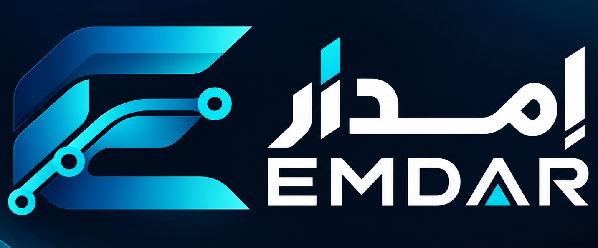

# إمدار | EMDAR

### من الإمداد إلى القرار.  
**From Supply to Decision.**

<p align="center">
  
</p>

<p align="center">
  <strong>AI-Powered Supply Chain Intelligence & Cyber Resilience Platform</strong>
</p>

---

## نبذة عن إمدار

**إمدار | EMDAR** هي منصة ذكية تجمع بين **الأمن السيبراني وذكاء سلاسل الإمداد** لمساعدة المنشآت على اكتشاف المخاطر والتهديدات مبكرًا، وفهم تأثيرها على العمليات، ومحاكاة السيناريوهات المحتملة، ثم الوصول إلى قرارات استباقية ومدروسة.

تربط إمدار بين:

- 🔐 التهديدات السيبرانية
- 🚢 الموانئ والمسارات البحرية
- 📦 الشحنات
- 🏭 الموردين
- 📊 المخاطر التشغيلية
- 📦 المخزون
- 🛃 الجمارك والامتثال
- 💰 الأثر المالي
- 🔄 استمرارية الأعمال

وذلك لتحويل المخاطر المعقدة إلى **قرارات واضحة وقابلة للتنفيذ**.

---

## 🎯 الفكرة

بدلًا من التعامل مع الأمن السيبراني وسلسلة الإمداد كأنهما مجالان منفصلان، تقوم إمدار بربطهما في منصة واحدة.

فمثلًا، إذا تم اكتشاف تهديد سيبراني يستهدف أحد الموردين أو أنظمة أحد الموانئ، لا تتوقف المنصة عند اكتشاف التهديد، بل تحلل:

> ما هو الهجوم؟  
> كيف دخل؟  
> ما الذي يستهدفه؟  
> من سيتأثر؟  
> كيف يمكن أن ينتشر عبر سلسلة الإمداد؟  
> ما تأثيره المالي والتشغيلي؟  
> ماذا يمكن أن يحدث لاحقًا؟  
> وما أفضل خطة استجابة؟

---

## 🛡️ الأمن السيبراني

يُعد الأمن السيبراني أحد المحاور الأساسية في EMDAR.

تدعم المنصة تحليل سيناريوهات مثل:

- Ransomware
- Phishing & Credential Theft
- Supply Chain Compromise
- Third-Party Compromise
- DDoS
- Malware
- Data Exfiltration
- Insider Threat
- Unauthorized Access
- Data Integrity Issues
- Communication Network Disruption
- Port Management System Outage
- Logistics Network Disruption
- Navigation System Anomaly

وتعرض المنصة لكل تهديد:

- نوع الهجوم
- تصنيف التهديد
- نقطة الدخول المحتملة
- الأنظمة والأصول المستهدفة
- الموردين المتأثرين
- الموانئ المتأثرة
- الشحنات المتأثرة
- مستوى الخطورة
- احتمالية الحدوث
- مستوى الثقة
- درجة المخاطر
- الخط الزمني للهجوم
- احتمالية انتشار التأثير
- الأثر المالي
- الأثر التشغيلي
- الأثر على سلسلة الإمداد
- إجراءات التخفيف والاستجابة
- خطة التعافي وإعادة التخطيط

> **ملاحظة:** جميع التهديدات والسيناريوهات التنبؤية في النموذج الأولي هي لأغراض المحاكاة والعرض وليست تنبؤات مؤكدة.

---

## 🧠 كيف تعمل إمدار؟

### DETECT
اكتشاف المخاطر والتهديدات والمؤشرات المبكرة.

### ANALYZE
تحليل مصدر الخطر وتأثيره على الأنظمة والموردين والموانئ والشحنات.

### SIMULATE
محاكاة السيناريوهات المحتملة ودراسة ما قد يحدث.

### RECOMMEND
مقارنة البدائل وتحديد الخطة الموصى بها.

### RESPOND
تحويل التوصية إلى خطة استجابة عملية.

### RECOVER
دعم التعافي واستعادة العمليات وإعادة التخطيط عند تغير الظروف.

### المسار الكامل:

**اكتشاف → تحليل → محاكاة → توصية → استجابة → تعافٍ**

---

## 🌐 الموانئ وسلاسل الإمداد

تربط EMDAR المخاطر الرقمية بالتأثير الواقعي على سلسلة الإمداد.

يمكن للمنصة تحليل:

- الموانئ
- المسارات البحرية
- الموردين
- الشحنات
- المخزون
- المستودعات
- شركات النقل
- العمليات الجمركية
- الأنظمة الرقمية
- الأصول المتأثرة

كما يمكن عرض المخاطر على خريطة توضح:

- مناطق المخاطر
- الموانئ
- المسارات البحرية
- الشحنات
- التهديدات السيبرانية
- مناطق التعطل
- حالة التشغيل

---

## 🔬 Scenario Simulator

تسمح إمدار بمحاكاة سيناريوهات مختلفة، مثل:

- Cyberattack on Port
- Port System Outage
- Maritime Route Disruption
- GPS / AIS Anomaly
- Port Congestion
- Supply Shortage
- Supplier Cyber Incident
- Third-Party Compromise
- Simulated Strait of Hormuz Disruption

ثم يتم تحليل:

- الشحنات المتأثرة
- الموانئ المتأثرة
- التأخير المتوقع
- تأثير المخزون
- خطر نفاد المخزون
- التكلفة
- الأثر التشغيلي
- المخاطر السيبرانية
- مخاطر سلسلة الإمداد
- استمرارية الأعمال

---

## 🔀 مقارنة خطط الاستجابة

تتيح EMDAR مقارنة عدة خطط قبل اتخاذ القرار:

### Plan A — Fastest
الخطة الأسرع.

### Plan B — Balanced
الخطة المتوازنة بين الوقت والتكلفة والمخاطر.

### Plan C — Lowest Cost
الخطة الأقل تكلفة.

وتتم مقارنة الخطط بناءً على:

- التكلفة
- الوقت
- مستوى المخاطر
- المسافة
- السعة
- الأثر التشغيلي
- تأثير المخزون
- المخاطر السيبرانية
- استمرارية الأعمال

ثم تقدم EMDAR **الخطة الموصى بها** مع توضيح سبب التوصية.

---

## 🔄 Dynamic Re-planning

لا تتعامل EMDAR مع القرار على أنه ثابت.

عند تغير الظروف، مثل زيادة مدة التعطل من **5 أيام إلى 8 أيام**، يمكن إعادة تحليل:

- تأخير الشحنات
- التعرض للمخزون
- احتمالية نفاد المخزون
- التكلفة
- الأثر التشغيلي
- مستوى المخاطر
- الخطة الموصى بها

مع عرض:

**What Changed?**

و

**What EMDAR Recommends Now**

---

## 💰 التأثير المالي

تعرض المنصة الآثار المالية باستخدام:

**Saudi Riyal — SAR — ر.س**

مثل:

- تكلفة الشحن
- تكلفة الاستجابة
- الخسائر التشغيلية المحتملة
- قيمة المخزون المعرض للخطر
- تكلفة البدائل
- الأثر المالي للسيناريو

---

## 🇸🇦 لماذا إمدار؟

تم تصميم EMDAR برؤية تناسب بيئة الأعمال وسلاسل الإمداد في المملكة العربية السعودية والمنطقة، مع التركيز على:

- المرونة التشغيلية
- الأمن السيبراني
- استمرارية الأعمال
- الموانئ والطرق البحرية
- الموردين
- المخزون
- اتخاذ القرار المبني على البيانات

---

## ✨ أبرز المزايا

| الميزة | الوصف |
|---|---|
| 🔐 Cyber Intelligence | تحليل التهديدات والمخاطر السيبرانية |
| 🌐 Supply Chain Intelligence | فهم شبكة سلسلة الإمداد |
| 🗺️ Risk Map | تصور المخاطر والموانئ والمسارات |
| 🔬 Scenario Simulator | محاكاة السيناريوهات |
| 🔀 Response Planning | مقارنة خطط الاستجابة |
| 🔄 Dynamic Re-planning | إعادة التخطيط عند تغير الظروف |
| 📦 Inventory Intelligence | تحليل المخزون المعرض للخطر |
| 🚢 Maritime Intelligence | تحليل الموانئ والمسارات البحرية |
| 💰 Financial Impact | تقدير الأثر المالي |
| 📊 Decision Support | تحويل البيانات إلى قرارات |

---

## 🖥️ تجربة المنصة

تم تصميم واجهة EMDAR بأسلوب:

- Enterprise-grade
- Cybersecurity-focused
- Modern
- Premium
- Responsive
- Arabic RTL
- English LTR
- Dark Mode
- Light Mode

مع استخدام هوية بصرية مستوحاة من الأمن السيبراني وذكاء سلاسل الإمداد.

---

## 🧪 Demo Mode

يوفر النموذج الأولي وضعًا تجريبيًا يسمح باستكشاف المنصة دون الحاجة إلى حساب.

تظهر البيانات التجريبية بوضوح على أنها:

**Simulated Demo Data**

وتستخدم السيناريوهات والنتائج التقديرية لأغراض العرض والمحاكاة.

---

## 🔐 Security by Design

تم تصميم المنصة مع مراعاة مبادئ الأمن الأساسية، مثل:

- Authentication
- Role-Based Access Control
- Protected Routes
- Secure Sessions
- Input Validation
- Audit Logging
- User Data Isolation
- Defensive Cybersecurity Workflows

ولا تتضمن المنصة أي وظائف هجومية أو أدوات لاختراق الأنظمة.

---

## 🏗️ التقنية

النسخة الحالية عبارة عن نموذج أولي تفاعلي لعرض تجربة EMDAR ومفاهيمها الأساسية.

يتضمن المشروع:

- HTML
- CSS
- JavaScript
- Responsive UI
- Arabic / English Localization
- RTL / LTR Support
- Interactive Simulations
- GitHub Pages Deployment

---

## 📁 هيكل المشروع

```text
Emdar-إمدار/
│
├── index.html
├── emdarlogo.jpeg
└── README.md
```

---

## 🚀 تشغيل المشروع

يمكن تشغيل المشروع محليًا بفتح:

```text
index.html
```

أو نشره باستخدام **GitHub Pages**.

---

## 🌐 النموذج الأولي

يمكن تجربة النموذج الأولي لمنصة EMDAR من خلال:

```text
https://emdar-supply-flow.base44.app
```

---


Cybersecurity & Supply Chain Intelligence Project

---

## 📌 Project Vision

> **إمدار لا تكتفي بإخبارك بوجود الخطر، بل تساعدك على فهمه، ومحاكاته، ومعرفة تأثيره، ثم اتخاذ القرار المناسب.**

### من الإمداد إلى القرار.

**EMDAR | إمدار**
